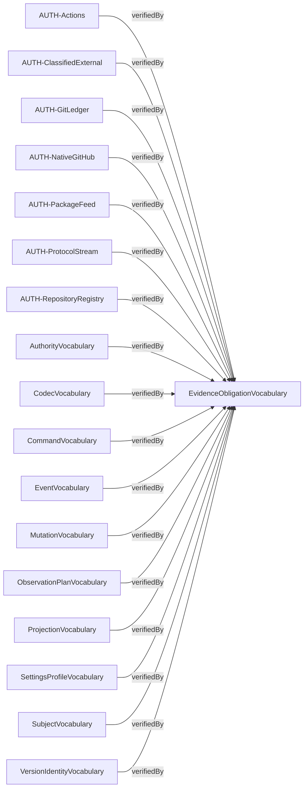
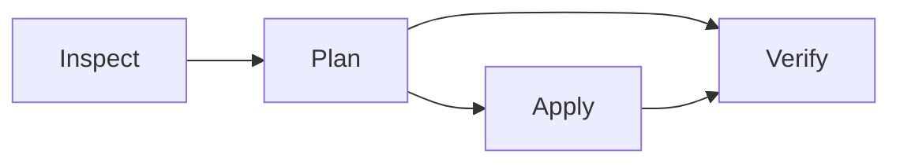

# Compiled contract diagrams

Source: `fd8ee59710f4855883061dc8d970eb7d7a80c910af79a9bed69f8c5217fbda4c`

Behavior: `9d2581c99badfb89acdb359acceb0a1ba560322939d47944e58aa1fdcf10e05b`

Contract: `791c65eacbc4ef93484673ed6c40d3e8ca21fd75f34371e58c9f954f757c1a64`

